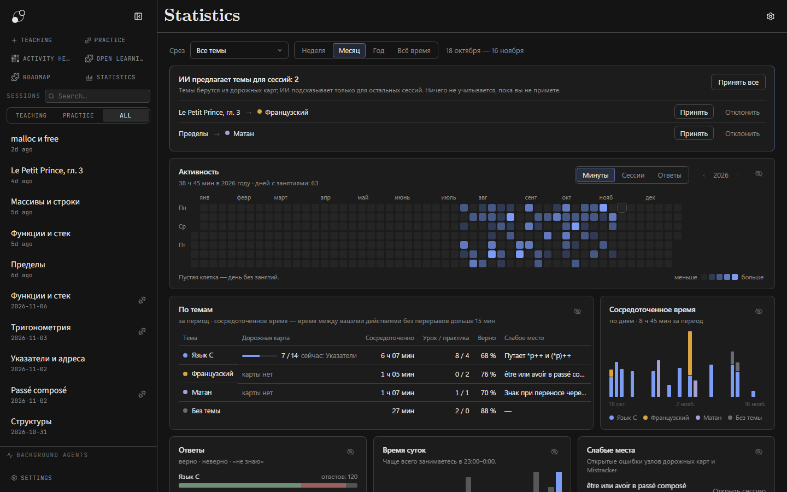

# Statistics — LearnHarness plugin

Learning statistics **by topic**: a GitHub-style activity calendar, focused time,
answers, time of day and weak spots — in one calm screen, without streaks or
points.



Statistics is a LearnHarness Community plugin (`apiVersion: 1`, id `statistics`,
LearnHarness 0.6.0 or newer). English and Russian interface (Settings →
Statistics → Interface language; *Auto* follows the system).

## What you see

- **Slice and period.** One drop-down: all topics or one topic. Periods: week,
  month, year, all time.
- **Activity.** A year calendar like a GitHub profile: minutes, sessions or
  answers per day. Hover a day to see how it splits across topics. Shades follow
  your own usual day (quartiles of your active days) but never drop below 15, 30
  and 60 minutes, so a first short day does not look full. An empty cell is
  simply a day without study — there are no streaks.
- **By topic.** For each topic: roadmap progress and the current module, focused
  time, lessons/practice, share of correct answers, propositions in the
  Knowledge Graph (once the graph has any) and the top weak spot. Pick a roadmap
  topic and the table switches to its modules.
- **Focused time** by day, week or month, stacked by topic.
- **Answers** — correct, wrong and "I don't know", per topic or module.
- **Time of day** — when you actually study.
- **Weak spots** — open errors from roadmap nodes and saved Mistracker entries,
  repeated ones first, each with a link to the session where it happened.

Every block can be hidden and brought back.

**Focused time** is the time between your own actions in a session (messages,
answers, practice submissions); a pause longer than the break threshold
(15 minutes by default) is a break and is not counted.

## Where topics come from

A LearnHarness session is just a conversation, so Statistics assigns topics in
exactly two ways:

1. **Roadmap.** A session started from a node of a
   [Roadmap](https://github.com/Doshhhh/roadmap-learnharness) (or Learning Paths)
   roadmap belongs to that roadmap. No AI involved.
2. **AI suggestion.** For every other session a cheap model reads the title, your
   first messages and the session's Knowledge Graph concepts, and picks one of
   your topics — or proposes a short new one. In **Suggest** mode (the default)
   nothing counts until you press *Accept*; in **Automatic** mode existing topics
   are applied directly, but a new topic is always created only by you. Each
   session is looked at once, at most 40 per run.

Sessions without a topic are shown honestly as *Without topic*.

## Settings

| Setting | Default |
| --- | --- |
| Interface language | Auto |
| Break after, minutes | 15 |
| Weak spots from Mistracker | On |
| AI topic suggestions | Suggest (Off / Suggest / Automatic) |
| Model for suggestions | The host's cheap model, or choose one |
| Your topics | Add, rename, delete (roadmaps are topics automatically) |
| Look at sessions again | Forget dismissed/unmatched AI decisions |

## Install

1. Download `statistics-<version>.zip` from the latest release.
2. In LearnHarness open **Settings → Community plugins** and copy the plugins
   directory path.
3. Unzip there so that `<plugins-directory>/statistics/dist/manifest.json` exists.
4. Press **Refresh**, enable **Statistics** and restart LearnHarness.

From source:

```sh
git clone https://github.com/Doshhhh/statistics-learnharness.git
cd statistics-learnharness
npm ci
npm run install:local -- "<plugins-directory>"
```

## Privacy and data

Statistics only **reads** your sessions, the Knowledge Graph and the data
folders of Roadmap, Learning Paths and Mistracker; it never writes them. Its own
files (`settings.json`, `topics.json`, `assignments.json`) live in
`<plugins>/statistics/data/`. AI suggestions send the session title, the first
~400 characters you wrote and concept names to the model you configured, through
LearnHarness's own connection.

## Development

```sh
npm ci
npm test            # Node test runner, no model or network
npm run typecheck   # needs the LearnHarness plugin SDK types in .sdk/
npm run build
```

## Credits

- [Activity Heatmap](https://github.com/Huskhd/learnharness-activity-heatmap) by
  Huskhd — the idea of an activity calendar and of focused time inside
  LearnHarness.
- The layout follows the statistics screen of Anki and the GitHub profile.

## License

[MIT](./LICENSE)
